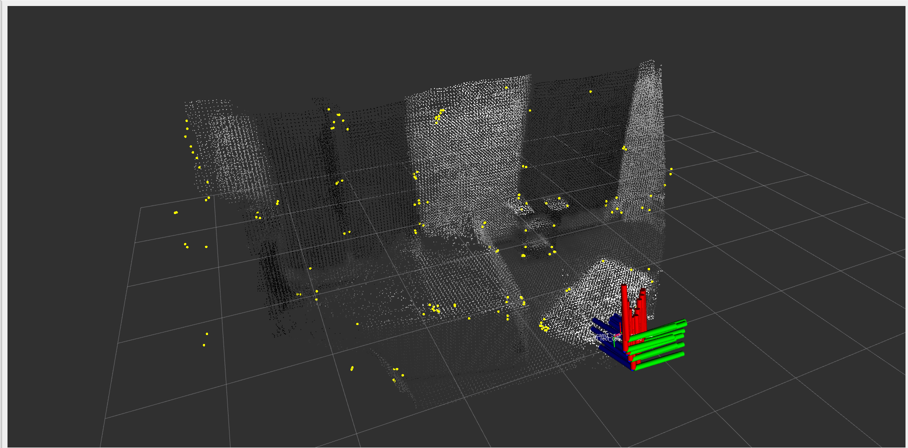
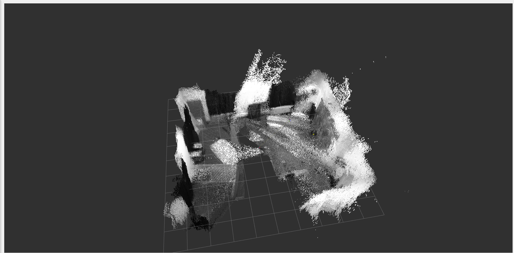
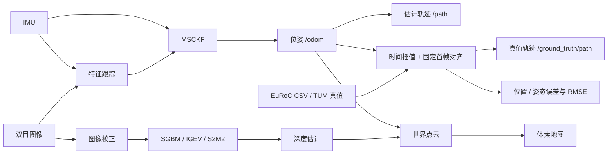

# MSCKF VIO + 双目三维重建（ROS 2）

基于 ROS 2 Humble 的双目视觉惯性里程计与点云重建系统。在 MSCKF 位姿估计的基础上，增加独立的双目重建节点，支持 **OpenCV SGBM**、**IGEV TensorRT** 和 **S2M2 TensorRT** 三种视差后端，完成图像校正、深度估计和世界坐标系下的点云融合。同时支持 **VIO 轨迹发布、按时间同步的真值对比，以及 evo 离线误差评估与绘图**。



*EuRoC 数据的 RViz 可视化效果：双目重建点云、稀疏特征点与位姿坐标轴。*



*融合点云地图的俯视效果，可观察室内墙面与场景结构。*

按阶段理解实现，可阅读 [Stereo 代码阅读指南](docs/stereo_code_walkthrough.md)。

## 功能与处理流程

- **双目 VIO**：跟踪双目特征，融合 IMU，输出位姿、轨迹和稀疏特征点。
- **轨迹发布**：通过 `/path` 发布完整的 `nav_msgs/Path`，支持后加入的订阅者获取已有轨迹。
- **真值同步对比**：通过 launch 参数 `ground_truth:=...` 加载 EuRoC CSV / TUM 真值，按估计时间戳插值，在 RViz 叠加轨迹并发布位置、姿态误差及累计位置 RMSE。
- **离线评估与绘图**：导出 TUM 轨迹，用 evo 计算 APE / RPE、保存三维轨迹和误差图；项目脚本处理 Matplotlib 混用与无图形界面导出问题。
- **图像校正**：复用 MSCKF 的相机标定，支持 radtan 和 equidistant 畸变模型。
- **视差与深度**：通过虚函数接口 `StereoMatcher` 切换 SGBM / IGEV / S2M2，输出浮点像素视差和米制深度。
- **点云融合**：按图像时间戳匹配位姿，将点云变换到 VIO 世界坐标系，通过关键帧筛选和体素融合构建地图。
- **地图管理**：RViz 显示，PCD / PLY 导出，以及清空地图服务。



重建节点独立于 MSCKF，三个后端共享校正、位姿匹配和点云融合逻辑。当前实现为点云重建，不包含闭环优化、TSDF、网格生成或历史点云随优化位姿重新融合；地图会受到 VIO 漂移的影响。

## 环境与依赖

| 组件 | 本地验证环境 |
| --- | --- |
| 系统 | Ubuntu 22.04 / ROS 2 Humble |
| 语言 | C++17 / Python 3.10 |
| 基础库 | Eigen 3.4、OpenCV 4.5、PCL 1.12、Boost、SuiteSparse |
| 真值对比 | rclpy、NumPy、PyYAML，由 ROS 包依赖声明 |
| 离线评估可选依赖 | evo、Matplotlib |
| TensorRT 后端可选依赖 | TensorRT 10.x、CUDA Runtime、NVIDIA GPU |
| IGEV 本地验证 | TensorRT 10.14 / CUDA 13.1 / GTX 1650 Ti |

SGBM 和 VIO 无需 TensorRT / CUDA。以下命令假设仓库位于 `~/ros_ws/msckf_vio/src/msckf_vio`，工作空间根目录为 `~/ros_ws/msckf_vio`。

```bash
source /opt/ros/humble/setup.bash
cd ~/ros_ws/msckf_vio

sudo apt install -y libeigen3-dev libopencv-dev libpcl-dev libboost-dev libsuitesparse-dev
rosdep install --from-paths src --ignore-src -r -y
```

## 编译

### SGBM / 仅运行 VIO

```bash
cd ~/ros_ws/msckf_vio
source /opt/ros/humble/setup.bash

CMAKE_BUILD_PARALLEL_LEVEL=2 colcon build --packages-select msckf_vio \
  --cmake-args -DCMAKE_BUILD_TYPE=Release -DMSCKF_ENABLE_TENSORRT=OFF
source install/setup.bash
```

### 启用 IGEV / S2M2 TensorRT

将 SDK 路径替换为本机安装位置。该配置同时保留 SGBM 后端。

```bash
cd ~/ros_ws/msckf_vio
source /opt/ros/humble/setup.bash

CMAKE_BUILD_PARALLEL_LEVEL=2 colcon build --packages-select msckf_vio \
  --cmake-args \
  -DCMAKE_BUILD_TYPE=Release \
  -DMSCKF_ENABLE_TENSORRT=ON \
  -DTensorRT_ROOT=/home/ros/lib/TensorRT-10.14 \
  -DCUDA_ROOT=/usr/local/cuda-13.1
source install/setup.bash
```

模型文件需要自行准备。将转换完成的 engine 放在 `src/msckf_vio/weights/igev/model.engine`，或在启动时指定绝对路径；权重不会随软件包安装，也不纳入 Git。

当前 IGEV engine 的接口为：

| 张量 | 类型 | 形状 |
| --- | --- | --- |
| `left` | FP32 | `[1, 3, 480, 768]` |
| `right` | FP32 | `[1, 3, 480, 768]` |
| `disparity` | FP32 | `[1, 1, 480, 768]` |

对 EuRoC 的 `752×480` 图像，后端自动在右侧补齐至 `768×480`，推理后裁回原尺寸，保留像素视差单位。当前导出图包含归一化，节点输入使用 RGB、NCHW、`[0,255]` 数据；更换模型时需核对预处理约定。详细接口见[双目重建说明](docs/stereo_reconstruction.md#igev-tensorrt-backend)。

## 运行 EuRoC

每个终端都需要加载工作空间，并使用相同的 `ROS_DOMAIN_ID`。以下启动方式会同时运行图像处理器、MSCKF、双目重建和 RViz。

### 1. 启动节点

**IGEV TensorRT：**

```bash
cd ~/ros_ws/msckf_vio
source install/setup.bash
export ROS_DOMAIN_ID=42

ros2 launch msckf_vio stereo_reconstruction_euroc.launch.py \
  backend:=igev \
  engine_path:="$(pwd)/src/msckf_vio/weights/igev/model.engine"
```

**SGBM：**

```bash
source ~/ros_ws/msckf_vio/install/setup.bash
export ROS_DOMAIN_ID=42

ros2 launch msckf_vio stereo_reconstruction_euroc.launch.py backend:=sgbm
```

**S2M2 TensorRT：**

```bash
ros2 launch msckf_vio stereo_reconstruction_euroc.launch.py \
  backend:=s2m2 \
  engine_path:="$HOME/ros_ws/msckf_vio/src/msckf_vio/weights/s2m2/S2M2_S_768_480_fp16.engine"
```

S2M2 使用 RGB UINT8 输入、居中补边与置信度/可见性过滤。新导出的 `S2M2_S_768_480_fp16.engine` 实际输入为 `[1,3,480,768]`，适用于 EuRoC。请勿误用旧的 `S2M2_S_480_768_fp16.engine`，它的高宽相反；节点会在启动时检查并报错。详见 [S2M2 接口说明](docs/stereo_reconstruction.md#s2m2-tensorrt-backend)。

三种方式选择其一。如果已有 MSCKF 在运行，追加 `start_vio:=false`，并确保标定、话题、时钟和 ROS 域一致；已有 RViz 时可追加 `rviz:=false`。

### 2. 播放数据

在另一个终端执行，将数据目录替换为自己的 ROS 2 bag 路径：

```bash
source ~/ros_ws/msckf_vio/install/setup.bash
export ROS_DOMAIN_ID=42

ros2 bag play /path/to/V2_01_easy_ros2 \
  --clock --rate 0.2 \
  --topics /imu0 /cam0/image_raw /cam1/image_raw
```

重建 launch 默认启用仿真时间，因此播放时需要 `--clock`。GTX 1650 Ti 上使用 IGEV 建议从 `--rate 0.2` 开始，S2M2 从 `--rate 0.1` 开始；SGBM 可先用 `--rate 0.5`，再按实际负载调整。推理跟不上输入时，重建队列会丢弃部分帧。

MSCKF 使用最初 200 条 IMU 消息初始化重力方向和偏置，开始时传感器应保持静止。重建在初始化完成且取得匹配位姿后开始。

EuRoC 原始 ROS 1 bag 需要先转换成 ROS 2 格式。播放时仅选择上述三个输入话题，可避开数据集中的自定义消息依赖。所有发布者和订阅者应使用同一个 ROS 域，避免与其他系统的 `/odom`、`/tf` 冲突。

### 3. 查看与导出

RViz 使用项目自带的重建配置，融合地图话题为 `/stereo/map`。

```bash
# 保存地图，默认路径 /tmp/stereo_map.pcd
ros2 service call /stereo/save_map std_srvs/srv/Trigger '{}'

# 改为导出 PLY，再调用保存服务
ros2 param set /stereo_reconstruction save_map_path /tmp/stereo_map.ply
ros2 service call /stereo/save_map std_srvs/srv/Trigger '{}'

# 清空地图、位姿缓存和待处理图像，不重置 MSCKF
ros2 service call /stereo/clear_map std_srvs/srv/Trigger '{}'
```

导出包含米制 XYZ 和 RGB 的 ASCII PCD / PLY，目录需事先存在，已有同名文件会被覆盖。EuRoC 为灰度图，点云颜色也是灰度。

## 话题与参数

| 话题 | 内容 |
| --- | --- |
| `/imu0` | IMU 输入，`sensor_msgs/Imu` |
| `/cam0/image_raw`、`/cam1/image_raw` | 同步双目输入，`sensor_msgs/Image` |
| `/odom` | MSCKF 位姿，`nav_msgs/Odometry` |
| `/path` | MSCKF 累积轨迹，`nav_msgs/Path`，坐标系与 `/odom` 一致 |
| `/stereo/left/image_rect`、`/stereo/right/image_rect` | 校正后的双目图像 |
| `/stereo/disparity` | `32FC1` 像素视差，无效值为 NaN |
| `/stereo/depth` | `32FC1` 深度，单位米，无效值为 NaN |
| `/stereo/points` | 当前帧点云，左校正相机坐标系 |
| `/stereo/points_world` | 当前帧点云，VIO 世界坐标系 |
| `/stereo/map` | 融合后的体素点云地图，VIO 世界坐标系 |

图像与单帧点云按订阅需求生成，使用 best-effort QoS；地图使用 reliable / transient-local QoS，可供新订阅者获取最近一次地图。

`/path` 随每次里程计输出更新，使用 reliable / transient-local QoS，后加入的订阅者可获取已有轨迹。手动调用 `/reset` 时清空轨迹；仅重置协方差的在线重置保留轨迹。轨迹保存本次运行的全部已发布位姿，历史位姿不会随滤波更新重新优化。

| 文件 | 用途 |
| --- | --- |
| [EuRoC VIO 参数](config/msckf_vio_euroc_params.yaml) | 相机和 IMU 标定、特征跟踪、滤波配置 |
| [重建参数](config/stereo_reconstruction_euroc_params.yaml) | 后端、深度范围、关键帧、体素和地图导出配置 |
| [重建详细说明](docs/stereo_reconstruction.md) | 坐标变换、时间同步、推理约定和扩展接口 |

常用重建参数包括 `backend`、`min_depth` / `max_depth`、`pixel_stride`、`voxel_size`、`max_voxels`、`keyframe_translation` 和 `keyframe_rotation_deg`。除 `save_map_path` 外，修改后应重启节点。

重建 launch 从 VIO 参数文件读取同一份几何标定。双目图像必须时间戳一致，输入尺寸必须匹配标定；换相机时需要更新内参、畸变、双目外参和 IMU 外参。矩阵参数使用 16 个按行排列的浮点数，避免混用 `0` 和 `0.0`。

## VIO 轨迹发布、真值对比与评估

### 发布与显示 VIO 轨迹

不需要稠密重建时，可单独启动 MSCKF：

```bash
ros2 launch msckf_vio msckf_vio_euroc.launch.py use_sim_time:=true
```

需要 RViz 时改用：

```bash
ros2 launch msckf_vio msckf_vio_euroc_viz.launch.py use_sim_time:=true
```

EuRoC VIO 和双目重建的 RViz 配置均已添加绿色 **VIO Path**，订阅 `/path`。
自行配置 RViz 时，添加 `Path` 显示，话题选择 `/path`，Fixed Frame 与 `/odom` 的
`header.frame_id` 一致（默认 `world`），Durability 选择 `Transient Local`、
Reliability 选择 `Reliable`，Buffer Length 设为 1。

轨迹与 `/odom` 使用相同的机体位姿、采集时间戳和世界坐标系，每次里程计输出追加一个点，
并发布完整历史。手动 `/reset` 或轨迹时间倒退时清空；仅重置协方差的在线重置保留轨迹。

同样使用 `--clock` 播放数据。其他入口包括 EuRoC 在线外参估计配置 `msckf_vio_euroc_noextrinsics.launch.py` 和 UPenn fast flight 配置 `msckf_vio_fla.launch.py`。

### 按时间同步显示真值与估计轨迹

在 launch 中指定 `ground_truth`，即可加载同一序列的 EuRoC
`mav0/state_groundtruth_estimate0/data.csv` 或 TUM 格式文本。以下以 **V2_03_difficult**
为例，将 `/path/to` 替换为实际目录；launch 参数使用 `:=`：

```bash
source /home/ros/ros_ws/msckf_vio/install/setup.bash
ros2 launch msckf_vio msckf_vio_euroc_viz.launch.py \
  use_sim_time:=true \
  ground_truth:=/path/to/V2_03_difficult/mav0/state_groundtruth_estimate0/data.csv
```

另一个终端播放对应 bag：

```bash
source /home/ros/ros_ws/msckf_vio/install/setup.bash
ros2 bag play /path/to/V2_03_difficult/V2_03_difficult --clock --rate 0.5 \
  --topics /imu0 /cam0/image_raw /cam1/image_raw
```

两个终端使用相同的 `ROS_DOMAIN_ID`。bag 与真值必须来自同一序列，例如不能播放
`V2_02_medium` 却加载 `V2_03_difficult` 的真值。切换序列前停止并重新启动 VIO。

RViz 中绿色 **VIO Path**（`/path`）为估计轨迹，红色 **Ground Truth Path**
（`/ground_truth/path`）为真值。
真值由 `/odom` 的消息时间戳驱动，位置线性插值、姿态 SLERP；暂停和变速播放不会
改变时间关联，不会提前显示整条真值轨迹。超出真值范围或跨越超过 50 ms 的缺口时
跳过匹配，不进行外推。`use_sim_time` 同时传给 VIO、对比节点和 RViz。

首组成功匹配的完整位姿确定固定的 SE(3) 对齐变换，此后不再拟合，也不调整尺度。
真值须描述 IMU 状态；节点使用 VIO 参数文件中的 `T_imu_body` 转换到同一个机体原点。
TUM 文件同样须使用 IMU 位姿、秒制采集时间戳和 `qx qy qz qw` 四元数顺序。
这是首帧对齐的在线对比，RMSE 与 evo 全轨迹最佳拟合后的 APE 不同。

| 话题 | 类型 / 含义 |
| --- | --- |
| `/ground_truth/path` | `nav_msgs/Path`，同步累积的真值轨迹，支持后加入的订阅者 |
| `/ground_truth/pose` | `geometry_msgs/PoseStamped`，时间戳和世界坐标系与当前估计相同 |
| `/ground_truth/position_error` | `std_msgs/Float64`，当前匹配位置误差，米 |
| `/ground_truth/orientation_error_deg` | `std_msgs/Float64`，当前姿态误差，度 |
| `/ground_truth/position_rmse` | `std_msgs/Float64`，本段首帧对齐后的累计位置 RMSE，米 |

对比节点每隔约 5 秒打印一次误差。手动 `/reset` 清空 VIO 轨迹时，同时清空真值轨迹、
对齐变换和统计；时间倒退也会清空对比状态，重新从头播放时仍需重新启动或重置 VIO。
仅重置协方差的在线重置不改变对齐。

也可以直接查看数值：

```bash
ros2 topic echo /ground_truth/position_error
ros2 topic echo /ground_truth/position_rmse
```

以上命令分别在终端运行，单位均为米。各 launch 的支持情况如下：

| launch | 行为 |
| --- | --- |
| `msckf_vio_euroc.launch.py` | VIO，可选加载真值 |
| `msckf_vio_euroc_viz.launch.py` | VIO + RViz，可选同步显示真值 |
| `stereo_reconstruction_euroc.launch.py` | VIO + 双目重建 + RViz，可选加载真值；`start_vio:=false` 时也可挂接已有 VIO |
| `ground_truth.launch.py` | 单独运行真值对比节点 |

前三种 launch 不传 `ground_truth` 时不会启动对比节点。已有 VIO 时，可单独启动：

```bash
ros2 launch msckf_vio ground_truth.launch.py \
  ground_truth:=/path/to/sequence/mav0/state_groundtruth_estimate0/data.csv \
  use_sim_time:=true
```

单独启动时用 `vio_params_file` 指定已有 VIO 使用的参数文件，`odom_topic` 和
`path_topic` 可覆盖估计话题。

### 离线轨迹评估

离线评估使用同一次运行的 `/odom` 和同一序列真值。本节命令从工作空间根目录
`~/ros_ws/msckf_vio` 执行，evo 需要另行安装。

**1. 记录估计轨迹。** 先启动 VIO 和录制器，再播放 bag；播放结束后，在录制器终端
按 Ctrl-C 保存并退出。录制器与 VIO 使用相同的 `ROS_DOMAIN_ID`。

```bash
cd ~/ros_ws/msckf_vio
source install/setup.bash
mkdir -p /tmp/vio_eval

python3 src/msckf_vio/scripts/record_odom.py /tmp/vio_eval/est.txt
```

**2. 转换同一序列的真值。**

```bash
python3 src/msckf_vio/scripts/gt_asl_to_tum.py \
  /path/to/V2_03_difficult/mav0/state_groundtruth_estimate0/data.csv \
  /tmp/vio_eval/gt.txt
```

估计和转换后的真值均为 TUM 格式，每行是：

```text
timestamp[s] x y z qx qy qz qw
```

时间戳保留传感器采集时间，不能替换为电脑当前时间。每次独立运行单独录制文件，
手动重置或切换数据集后重新录制。

**3. 计算 APE 并保存误差图。** 推荐使用项目的 `evo_run.py`，参数与 evo 相同，
将命令名 `evo_ape` 改为 `python3 .../evo_run.py ape`：

```bash
python3 src/msckf_vio/scripts/evo_run.py ape tum \
  /tmp/vio_eval/gt.txt /tmp/vio_eval/est.txt \
  --align --pose_relation trans_part --t_max_diff 0.01 \
  --save_results /tmp/vio_eval/ape.zip \
  --save_plot /tmp/vio_eval/ape.png
```

`--align` 仅做 SE(3) 旋转和平移对齐，`--t_max_diff 0.01` 允许最多 10 ms 的时间关联差。
双目 VIO 已有米制尺度，常规评估保留尺度误差，不添加 `--correct_scale`。
位置 APE 的 `rmse`、`mean`、`median`、`max` 均以米为单位。evo 根据整个匹配片段
做最佳拟合，因而与在线固定首帧对齐的 `/ground_truth/position_rmse` 不同。

**4. 保存三维轨迹叠加图。**

```bash
python3 src/msckf_vio/scripts/evo_run.py traj tum /tmp/vio_eval/est.txt \
  --ref /tmp/vio_eval/gt.txt --align --sync --t_max_diff 0.01 \
  --plot_mode xyz --save_plot /tmp/vio_eval/trajectory.png
```

需要俯视图时，将 `--plot_mode xyz` 改为 `--plot_mode xy`。

**5. 可选：计算局部漂移 RPE。** 以下比较沿真值轨迹每约 1 米路段的相对平移误差：

```bash
python3 src/msckf_vio/scripts/evo_run.py rpe tum \
  /tmp/vio_eval/gt.txt /tmp/vio_eval/est.txt \
  --pose_relation trans_part --delta 1 --delta_unit m --pairs_from_reference \
  --t_max_diff 0.01 --save_results /tmp/vio_eval/rpe.zip \
  --save_plot /tmp/vio_eval/rpe.png
```

输出文件包括：

| 文件 | 内容 |
| --- | --- |
| `/tmp/vio_eval/est.txt`、`gt.txt` | 估计与真值 TUM 轨迹 |
| `/tmp/vio_eval/ape.zip` | APE 统计与误差结果 |
| `/tmp/vio_eval/ape_raw.png` | 位置误差随时间变化 |
| `/tmp/vio_eval/ape_map.png` | 按位置误差着色的轨迹 |
| `/tmp/vio_eval/trajectory_trajectories.png` | 估计与真值轨迹叠加 |
| `/tmp/vio_eval/trajectory_xyz.png`、`trajectory_rpy.png`、`trajectory_speeds.png` | 位置、姿态及速度曲线 |
| `/tmp/vio_eval/rpe.zip`、`rpe_raw.png`、`rpe_map.png` | 可选的局部漂移结果与图像 |

导出图片默认使用 Agg 后端，无需图形界面；脚本让 `mpl_toolkits` 与实际导入的
Matplotlib 来自同一安装位置，并在当前进程中应用绘图后端，不修改全局 evo 配置。
若显式设置 `MPLBACKEND`，脚本优先采用该值，例如 `MPLBACKEND=Agg python3 ...`。

需要弹窗交互时，在有图形界面且 Qt / Tk 可用的桌面终端执行：

```bash
python3 src/msckf_vio/scripts/evo_run.py ape tum \
  /tmp/vio_eval/gt.txt /tmp/vio_eval/est.txt \
  --align --pose_relation trans_part --t_max_diff 0.01 --plot
```

## 验证

```bash
colcon build --packages-select msckf_vio --cmake-args -DBUILD_TESTING=ON
colcon test --packages-select msckf_vio --return-code-on-test-failure
colcon test-result --verbose
```

测试覆盖 SGBM 视差尺度、深度与坐标变换、位姿匹配、体素融合、地图导出，以及 IGEV 的输入布局、补边、FP16 转换和无效输出处理。

真值对比测试见 [test/test_ground_truth.py](test/test_ground_truth.py)，覆盖 EuRoC / TUM
解析、纳秒时间戳、位置与姿态插值、禁止外推、数据缺口、机体外参、固定对齐、误差统计、
重置和时间倒退。另已通过独立 ROS 域的 launch 冒烟验证：同步发布、暂停时不提前播放、
后加入订阅者获取轨迹，以及普通 / RViz / 重建 launch 和挂接已有 VIO 的模式。

本地 EuRoC `V2_01_easy` 短序列集成验证结果：

| 后端 | 数据时长 / 播放倍率 | 深度帧数 | 融合地图点数 |
| --- | --- | --- | --- |
| SGBM | 前 15 秒 / 0.5 倍速 | 279 | 195,987 |
| IGEV TensorRT | 前 8 秒 / 0.25 倍速 | 122 | 41,851 |
| S2M2 TensorRT | 前 8 秒 / 0.2 倍速 | 94 | 33,009 |

上述验证均通过地图保存与清空检查。数据时长和运行负载不同，这些数字用于确认链路可运行，不用于比较后端精度或宣称实时性能。复现脚本见 [test/stereo_ros_smoke.py](test/stereo_ros_smoke.py)。

## 常见问题

- **IGEV 启动失败**：确认编译时启用了 `MSCKF_ENABLE_TENSORRT`，engine 文件非空，运行环境兼容，张量名称与配置一致。失败会报错退出，不会自动切换到 SGBM。
- **有位姿但没有地图**：检查双目时间戳、标定、`/clock` 和 `/odom`，以及是否存在对应时刻的位姿。挂接已有 VIO 时要使用它实际采用的标定文件。
- **动作快时跟踪点减少或 VIO 退化**：检查曝光、运动模糊、标定和相机 / IMU 同步，结合特征网格、检测阈值及跟踪统计排查。稠密重建不会反向修正 MSCKF 位姿。
- **地图错位或漂移**：先检查 VIO 轨迹及外参。重置 MSCKF 世界原点后，也应清空重建地图。
- **RViz 看不到图像或单帧点云**：检查话题和 QoS，图像 / 单帧点云订阅使用 best-effort；地图订阅使用 reliable / transient-local。
- **RViz 没有轨迹线**：确认 VIO 已初始化且 `/odom`、`/path` 有输出；Fixed Frame 默认 `world`，Path 显示使用 reliable / transient-local QoS。
- **`No new ground-truth match`**：先核对 bag 与真值是否属于同一序列，再比较 `/odom` 的采集时间与真值时间范围。序列开头或结尾可能没有真值，超出范围不会外推；超过 50 ms 的真值缺口或重复时间戳也会跳过。启用 `use_sim_time:=true` 时，播放 bag 加 `--clock`。
- **APE 已打印数值，但 `Axes3D` / `docstring` 导入失败**：这是系统版与 pip 版 Matplotlib 混用导致的绘图问题。改用上面的 `evo_run.py` 命令；保存图像使用 `--save_plot`，交互显示使用 `--plot`。
- **绘图报 `headless` / Qt backend 错误**：在无图形界面的终端使用 `evo_run.py ... --save_plot ...`；若环境预设了交互后端，显式加 `MPLBACKEND=Agg`。直接执行 `evo_ape` 时，evo 自身的后端配置可能覆盖该环境变量，项目脚本已处理这个问题。
- **RViz 提示 `Stereo is NOT SUPPORTED`**：这是显示设备的立体渲染提示，与双目图像同步或轨迹对比无关。

## 来源与许可

本项目基于 [KumarRobotics/msckf_vio](https://github.com/KumarRobotics/msckf_vio) 移植至 ROS 2，并扩展双目深度估计与点云融合。

- MSCKF 双目 VIO 论文：[Robust Stereo Visual Inertial Odometry for Fast Autonomous Flight](https://arxiv.org/abs/1712.00036)。
- 项目代码遵循 [Penn Software License](LICENSE.txt)；第三方代码和模型遵循各自许可。
