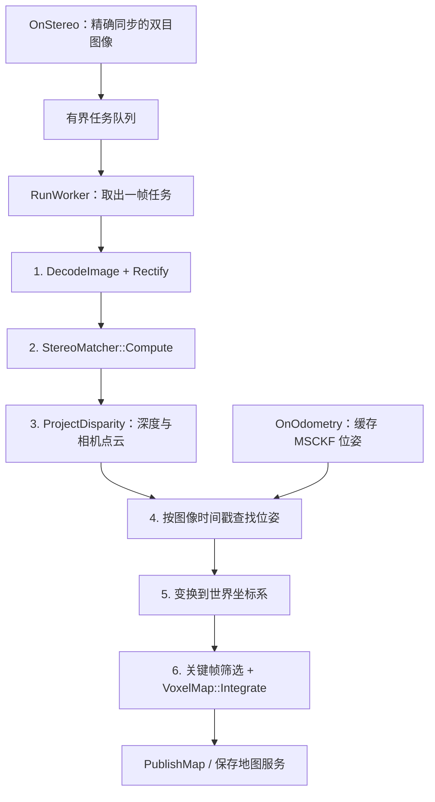

# Stereo 代码阅读指南

建议先读节点的 `ProcessFrame()`，再沿着它调用的视差后端和几何函数向下读。
代码中的“阶段”注释与下面的流程一致。



## 1. 节点入口与线程

[stereo_reconstruction_node.cpp](../src/stereo_reconstruction_node.cpp) 的构造函数按顺序执行：

- `LoadParameters()`：校验深度范围、时间容差，创建位姿缓存、关键帧选择器和地图。
- `CreateRectifier()`：读取标定与外参，预计算校正映射。
- `CreateMatcher()`：选择 SGBM、IGEV 或 S2M2，检查 engine 是否匹配标定分辨率。
- `CreateRosInterfaces()`：创建话题、服务、精确时间同步器及地图发布定时器。
- 最后启动 `RunWorker()`，避免在初始化尚未完成时开始处理图像。

图像回调只排队；耗时计算在工作线程完成。`state_mutex_` 保护任务队列和位姿缓存，
`map_mutex_` 保护地图。需要同时持有时，顺序固定为 **state → map**。

清空地图时会递增 `generation_`。旧任务即使还在 GPU 上运行，也不能将结果融合进
清空后的新地图。队列满时丢弃最旧任务，避免积压形成不断增长的延迟。

## 2. 所有后端共用的视差约定

[stereo_matcher.h](../include/stereo_recon/stereo/stereo_matcher.h) 定义虚接口：

```cpp
cv::Mat Compute(const cv::Mat& left, const cv::Mat& right);
```

输入是已校正的等大 mono8/BGR8 图像。输出必须满足：

- `CV_32FC1`，尺寸与原图一致。
- 左视差 `d = x_left - x_right`，单位为原图像素。
- 无效像素为 `NaN`，后续深度投影据此跳过。

SGBM 原始结果是放大 16 倍的定点视差，因此后端会除以 16。
IGEV/S2M2 已经输出像素视差，不执行这个转换。

## 3. TensorRT 推理的四个阶段

[tensorrt_stereo_matcher.cpp](../src/stereo/tensorrt_stereo_matcher.cpp) 的
`TensorRtStereoRuntime::Compute()` 是推理入口：

1. **模型预处理**：转换颜色、数据类型和布局，补边并保存原图 ROI。
2. **PrepareBindings**：解析实际张量形状，复用 host/device 缓冲区并绑定地址。
3. **传输与执行**：在同一 CUDA stream 上顺序执行 H2D、`enqueueV3`、D2H。
4. **模型后处理**：同步后读取结果，恢复 FP32、裁边并过滤无效视差。

S2M2 下载视差、可见性和置信度三个输出；IGEV 下载配置指定的视差输出。
engine 的其他输出也会绑定设备缓冲区，避免执行时缺少必需的 I/O 地址。
`StreamFence` 确保异常退出时传输也已结束，host 数据不会被提前释放或复用。

### IGEV 预处理

[igev_processing.cpp](../src/stereo/igev_processing.cpp)：

- 灰度复制为三通道，BGR 转 RGB，转为 FP32 NCHW，保留 `[0,255]`。
- 归一化已在模型内执行，不能再次除以 255。
- `right_bottom` 为右/下补零；`sintel` 为居中复制边缘。输出按对应 ROI 裁回。

### S2M2 预处理与质量掩码

[s2m2_processing.cpp](../src/stereo/s2m2_processing.cpp)：

- 居中补零，经 `AdaptiveAveragePool()` 和双线性插值生成边缘填充值。
- 恢复原图区域像素，输出 RGB UINT8 NCHW。浮点转 UINT8 采用截断，匹配上游。
- 视差、置信度、可见性必须裁剪同一个 ROI，保证像素对应。
- 有效像素要求视差有限且大于 0，置信度与可见性有限并严格大于各自阈值。
- `output_occ` 的数值越大表示越可见；低质量像素被设为 `NaN`。

ROS 参数会覆盖 C++ 参数结构的默认值，运行阈值以实际加载的 YAML 为准。
当前置信度用于硬过滤，尚未作为体素融合的连续权重。

## 4. 从视差到米制点云

[reconstruction.cpp](../src/stereo/reconstruction.cpp) 中：

- `StereoRectifier` 缓存校正映射、投影矩阵、Q 和左右有效区域掩码。
- `ProjectDisparity()` 验证左右对应落点，用 Q 计算齐次坐标，再除以 W。
- 深度表示左校正相机的光轴 Z，单位米。`pixel_stride` 只抽样点云，深度图保持完整。

变换统一采用 `t_a_b` 表示 **B → A**。校正改变了相机坐标轴，因此有：

```text
t_world_left_rect = t_world_body * t_body_left * inverse(R1)
```

这里 `R1` 是原左目到校正左目的旋转；代码将其逆旋转预先放入
`body_from_left_rect()`。遗漏这一项会让点云方向与位姿不一致。

## 5. 位姿匹配、融合与导出

`PoseBuffer::Find()` 查询图像采集时刻的位姿，而不是推理完成时刻的最新位姿。
默认零容差要求精确匹配；正容差允许最近邻，但没有位姿插值。

`KeyframeSelector` 比较与上次已融合位姿的平移和转角。通过筛选后，
`VoxelMap::Integrate()` 将点变换到世界坐标系，再用 `floor()` 确定体素索引，
正确处理负坐标，累计体素位置和颜色。观测数封顶后继续缓慢更新。

当前地图是体素质心点云，尚未实现 TSDF。导出通过 `SavePointCloud()` 写入
ASCII PCD/PLY。保存时先在锁内取得地图快照，再在锁外写文件。

## 6. 格式与检查

格式配置见项目根目录 [.clang-format](../.clang-format)，基于
[Google C++ Style Guide](https://google.github.io/styleguide/cppguide.html)：
2 空格缩进、80 列、include 分组、显式控制流括号、函数 PascalCase、
普通变量 snake_case、类成员尾随下划线；简单访问器保留小写命名。
外部库要求的覆写方法（如 TensorRT `ILogger::log`）沿用其接口名称。

仅整理 Stereo 相关文件，命令从仓库根目录执行（clang-format 15+）：

```bash
clang-format --dry-run --Werror \
  include/stereo_recon/stereo/*.h src/stereo/*.cpp \
  src/stereo_reconstruction_node.cpp \
  test/igev_processing_test.cpp test/s2m2_processing_test.cpp \
  test/stereo_reconstruction_test.cpp

cpplint --root=include --filter=-legal/copyright,-build/c++17 \
  include/stereo_recon/stereo/*.h src/stereo/*.cpp \
  src/stereo_reconstruction_node.cpp \
  test/igev_processing_test.cpp test/s2m2_processing_test.cpp \
  test/stereo_reconstruction_test.cpp
```

cpplint 不检查逐文件版权声明和其旧的 C++17 限制：项目许可由根目录 LICENSE.txt
保留，编译标准维持现有 C++17。CUDA 的平铺头文件名有一处局部 lint 豁免。
